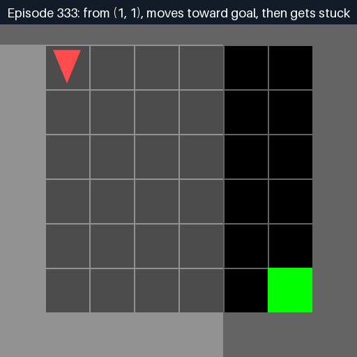

# Harvard Hacks 2026 × Daytona

Workshop demo: teach a tabular Q-learning agent to reach a goal in Farama’s [MiniGrid](https://github.com/Farama-Foundation/Minigrid), then run the same CPU workload inside a Daytona sandbox through the Python SDK.

## Run it

Install the project dependencies, then run locally:

```bash
uv sync
uv run python main.py --backend local
```

To run training in a Daytona CPU sandbox, configure `DAYTONA_API_KEY` (and `DAYTONA_API_URL` / `DAYTONA_TARGET` if needed), then run:

```bash
uv run python main.py --backend daytona
```

The Daytona path creates a temporary sandbox, installs MiniGrid and Pillow there, uploads the learner and CLI, runs training and GIF rendering inside the sandbox, downloads the GIFs into `display/`, and deletes the sandbox. The local `DAYTONA_API_KEY` is read from `.env` when present and is not copied into the sandbox. Add `--keep-sandbox` when inspecting the environment manually. Training defaults to 2,000 episodes in the 8×8 room and accepts `--episodes`, `--seed`, `--alpha`, `--gamma`, `--epsilon-start`, and `--epsilon-end`. Each run gets a unique asset ID; pass `--run-id` to set one explicitly. Run multiple independent learners with `--runs 100` and cap simultaneous sandboxes with `--concurrency 4`.

## Why tabular Q-learning

MiniGrid's fixed-goal Empty-8x8 task has a compact state representation for this introduction: 36 walkable cells × four facing directions (144 possible states), with three useful actions (turn left, turn right, move forward). A dictionary Q-table avoids neural-network setup and makes each update visible. The run reports recent success as it learns, then rolls out a greedy policy from several starts. The training loop is CPU-only; the larger episode budget remains a small CPU workload.

Batch mode queues any number of independent runs and uses bounded async orchestration to keep at most `--concurrency` jobs active at once. Each run gets its own seed, sandbox, and GIF filenames.

This first pass reads the agent’s position and direction from MiniGrid’s underlying simulator as a compact, fully observed state. It is intentionally a tabular-RL teaching setup, not a realistic partial-observation benchmark or a claim that a production agent can inspect simulator internals.

## Workshop plan

Use the 45-minute schedule in [PRESENTATION_PLAN.md](docs/PRESENTATION_PLAN.md). Suggested audience exercise: change epsilon decay or the learning rate, rerun, and compare the success curve and resulting policy. The display assets work in slides or on a booth screen without a live service connection.

## Display GIFs

An early policy moves close to the goal, then gets stuck two cells away:



The progression then shows the policy improving over training:


Final-policy rollouts: [start at (1, 1)](display/policy-8x8-showcase-start-1-1.gif) · [start at (1, 6)](display/policy-8x8-showcase-start-1-6.gif) · [start at (6, 1)](display/policy-8x8-showcase-start-6-1.gif). Each run generates a unique ID; pass `--run-id` to set one explicitly.

Other context: [CONTEXT.md](docs/CONTEXT.md) has organizer messages and the original concept; the internal schedule is in [the workbook](docs/INTERNAL%20HackHarvard2026%20Schedule.xlsx).
